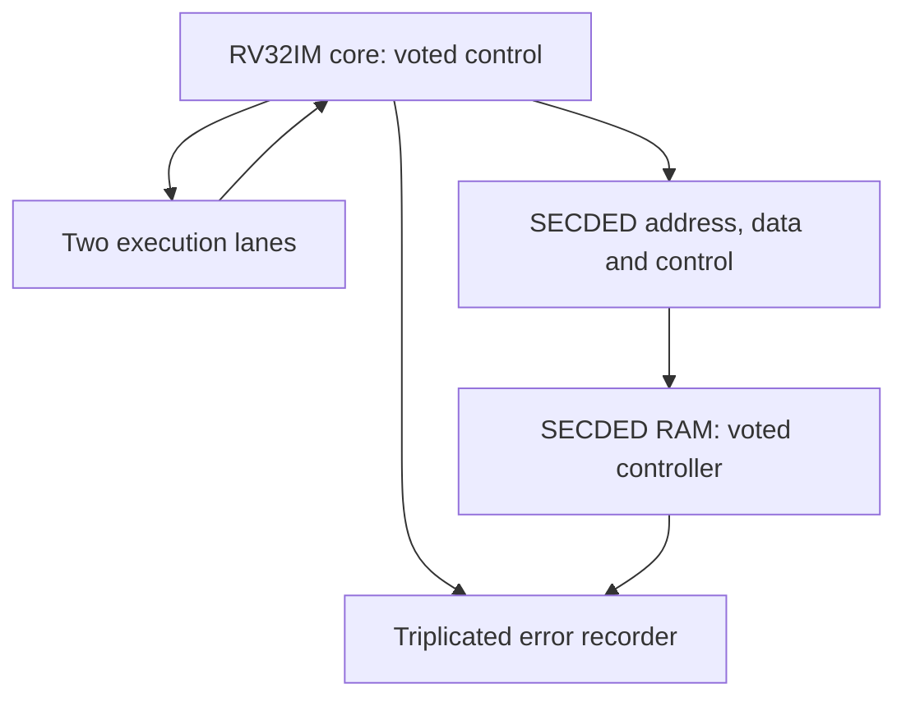

# RISCue architecture

The new five-stage machine core is described in PIPELINE_IMPLEMENTATION.md. The serialized architecture below belongs to the preserved legacy implementation.

The core serializes fetch, execution and memory transactions. It uses RV32IM semantics with a fail-stop execution environment; it is not a complete privileged RISC-V platform. The public module names retain `rv32im_ft_*` to avoid unnecessary interface churn.

Architectural registers use either SECDED or three voted replicas. Core control, RAM response/scrub state and error recorder state are triplicated. Correction feeds back into stored state; uncorrectable detections suppress retirement and drive defined error responses. Fault injection changes stored bits after same-cycle repair/write handling and is disabled by default.

The shared voting/commit logic, common-mode faults, physical placement, clock/reset and transient capture remain target-specific concerns. See [PROTECTION.md](PROTECTION.md), [STATE_MACHINE_AUDIT.md](STATE_MACHINE_AUDIT.md), and [FAULT_INJECTION.md](FAULT_INJECTION.md).

The optional RVFI instrumentation observes operand values, retirement, traps and memory byte masks. It is verification-only state and does not feed functional RTL. See [FORMAL.md](FORMAL.md) for proof contracts and the upstream signed-model correction.
