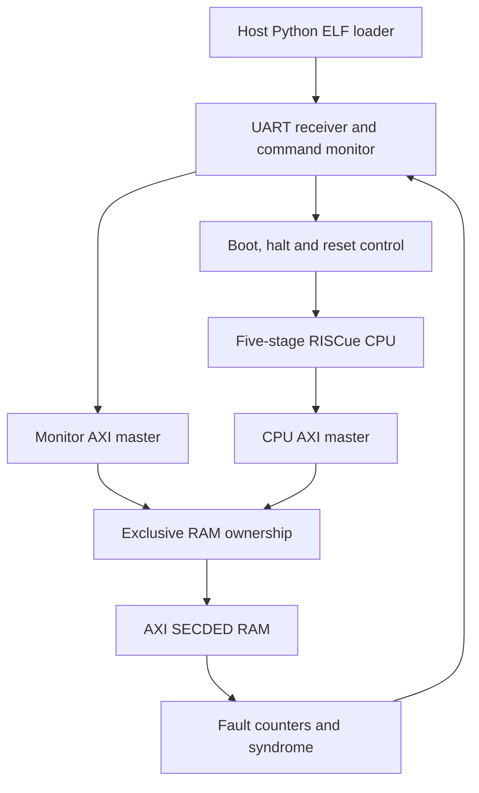
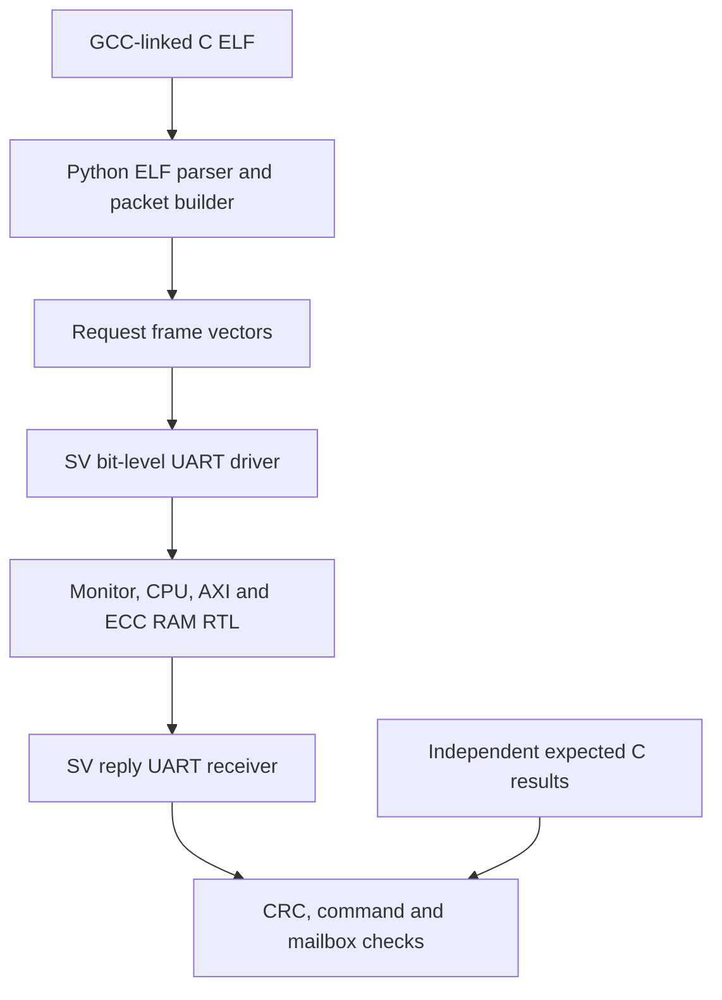

# RISCue developer and verification manual

**Implementation baseline: 0.7.6.** This manual describes the five-stage core, its fault-mitigation mechanisms, software contract, AXI interfaces, FPGA targets and executable test rigs. It also identifies the preserved legacy implementation so evidence is not attributed to the wrong core.

RISCue is an original RV32 processor prototype with ECC/TMR protection and digital fault-injection facilities. Compiled C and directed fault tests have passed in simulation. FPGA resource usage, achieved clock frequency, physical redundancy and radiation performance have not been established.

Code excerpts below are exact slices of repository files. Some are intentionally partial blocks; follow their source links for surrounding declarations and logic. `make docs` refreshes them, and `make docs-check` detects drift. The requirements and specialist guides remain linked from each chapter.

## Contents

1. [System configurations and source map](#system-configurations-and-source-map)
2. [Instruction and software contract](#instruction-and-software-contract)
3. [Five-stage pipeline](#five-stage-pipeline)
4. [Multiply, divide and bit manipulation](#multiply-divide-and-bit-manipulation)
5. [Machine mode, traps and interrupts](#machine-mode-traps-and-interrupts)
6. [ECC, TMR and failure containment](#ecc-tmr-and-failure-containment)
7. [Memory and AXI interfaces](#memory-and-axi-interfaces)
8. [Fault injection and telemetry](#fault-injection-and-telemetry)
9. [KC705 target and serial monitor](#kc705-target-and-serial-monitor)
10. [Compiling and loading C](#compiling-and-loading-c)
11. [The simulation test rig](#the-simulation-test-rig)
12. [Recorded results and reproduction](#recorded-results-and-reproduction)
13. [Formal verification](#formal-verification)
14. [FPGA implementation and bring-up](#fpga-implementation-and-bring-up)
15. [Debugging and troubleshooting](#debugging-and-troubleshooting)
16. [Requirements, maintenance and open work](#requirements-maintenance-and-open-work)

## System configurations and source map

The repository contains several integrations of related RTL. In particular, the processor AXI master and the ARM host-control AXI slave serve different purposes.

| Configuration | Top / principal modules | Intended use |
| --- | --- | --- |
| Current CPU | `riscue_pipeline_core` | Five-stage machine-mode CPU with an internal ECC-coded request interface |
| Local-memory pipeline SoC | `riscue_pipeline_soc` | CPU, local ECC SRAM and aggregated error recorder; many cocotb tests |
| Generic AXI processor | `riscue_axi_core` + `riscue_axi_master_bridge` | CPU instruction/data requests become AXI4-Lite master transactions |
| AXI ECC memory | `riscue_axi_ecc_ram` + `ft_ecc_ram` | AXI4-Lite slave, storage ECC, scrub and endpoint telemetry |
| KC705 serial development system | `riscue_monitor_soc`, board top `riscue_kc705` in `monitor_top.sv` | UART monitor and CPU share AXI ECC RAM; default KC705 build |
| KC705 VIO/ILA system | `riscue_kc705_legacy` + `riscue_kc705_lab` | Original instrumented board wrapper around the current local-memory pipeline; selectable alternative |
| KV260 ARM host system | `riscue_kv260_axi` + `riscue_axi_soc` | ARM-accessible control slave, local ECC RAM, loader/dashboard and injection campaigns |
| Legacy serialized prototype | `rv32im_ft_core`, `rv32im_ft_soc`, `rv32_execute` | Preserved RV32IM implementation and historical evidence |

“Legacy KC705 wrapper” means the earlier board integration; it still instantiates the five-stage pipeline. “Legacy serialized core” means the older `rv32im_ft_*` CPU. Neither phrase identifies the current default UART/AXI board configuration.



The monitor controls ownership at transaction boundaries. There is no round-robin arbitration between live CPU and host traffic in the serial development system.

| Source | Responsibility |
| --- | --- |
| [riscue_pipeline_pkg.sv](../rtl/riscue_pipeline_pkg.sv) | Packed stage/platform/arithmetic state and FI widths |
| [riscue_pipeline_core.sv](../rtl/riscue_pipeline_core.sv) | Pipeline movement, forwarding, retirement, CSRs, timer and RF protection |
| [riscue_rvc.sv](../rtl/riscue_rvc.sv) | Compressed instruction expansion |
| [riscue_execute.sv](../rtl/riscue_execute.sv) | Integer/bit-manipulation semantics and execution records |
| [riscue_muldiv.sv](../rtl/riscue_muldiv.sv) | Protected multicycle M arithmetic |
| [ft_pkg.sv](../rtl/ft_pkg.sv) | Shared ECC encode/decode and execution types |
| [ft_ecc_ram.sv](../rtl/ft_ecc_ram.sv) | Codeword storage, partial writes and scrub |
| [riscue_monitor_soc.sv](../rtl/riscue_monitor_soc.sv) | CPU/host AXI wiring, memory and monitor integration |
| [riscue_serial_monitor.sv](../rtl/riscue_serial_monitor.sv) | Packet validation, command lifecycle, run/stop and recovery |
| [kc705_monitor.py](../tools/kc705_monitor.py) | Host protocol and ELF loader |

## Instruction and software contract

The implemented pipeline profile is **RV32IMC + Zicsr + Zifencei + Zicntr + Zbb + Zbc + Zbs**, little-endian, M-mode only. The compiler contract is machine-readable in [software-profile.json](software-profile.json).

| Feature | Current behavior |
| --- | --- |
| Integer state | 32 architectural 32-bit registers; x0 always reads zero |
| Instruction alignment | IALIGN=16; 16-bit compressed and 32-bit instructions |
| Data alignment | Misaligned halfword/word accesses trap; byte accesses are supported |
| ABI | Standard ILP32; 16-byte stack alignment |
| FENCE | Ordering no-op with the serialized external transaction interface |
| FENCE.I | Serializes and flushes younger buffered/pending instruction fetch |
| WFI | Legal NOP; no sleep or clock-gating behavior |
| Privilege | Machine mode only; no U/S isolation or virtual memory |
| Unsupported families | A/Zalrsc/Zaamo, F/D, vector, Zba, Zicond and standard debug mode |
| Runtime | Bare-metal startup and examples; no provided libc, allocator, filesystem or syscall environment |

`misa=0x40001104` advertises RV32 I/M/C. The named Z extensions are specified by the software profile, not individually discoverable through `misa`. Do not infer a complete B aggregate: Zba is absent.

Typical generated compiler options are:

```sh
-march=rv32imc_zicsr_zifencei_zicntr_zbb_zbc_zbs -mabi=ilp32 \
-mcmodel=medlow -mstrict-align -mno-relax -msmall-data-limit=0 \
-ffreestanding -fno-builtin -fno-pic -fno-stack-protector
```

Use `make software-profile` to generate options rather than maintaining a separate hand-edited list. The post-link audit checks ELF identity/ABI, RISC-V architecture attributes and GNU-disassembled executable sections. It catches unsupported linked-library and assembly instructions; it is not a proof of reachability, dynamic code safety, MMIO correctness or hardware compliance. See [ELF compatibility](ELF_COMPATIBILITY.md) and [software ABI](SOFTWARE_ABI.md).

## Five-stage pipeline

| Stage | Role | Principal stall or redirect conditions |
| --- | --- | --- |
| IF (`f`) | Fetch ECC-coded words, select halfwords, assemble split 32-bit instructions, decompress | Unified bus occupied; IF buffer full; serialization; halt request |
| ID (`d`) | Identify source registers and accept decoded instruction into EX | EX occupied; older serial instruction; pending trap |
| EX (`x`) | Compared execution lanes, operand forwarding, branch/JALR decision, M handshake | Dependent load or multicycle arithmetic incomplete |
| MEM (`m`) | Checked loads/stores; internal CLINT accesses | External transaction or WB occupancy |
| WB (`w`) | Architectural register/CSR commit, retirement and precise trap entry | Trap/return/fence redirects discard younger work |

The stage records include validity, raw and expanded instructions, PC, instruction length, operands, exception metadata and execution results. The pipeline, machine state and retirement snapshot reside in a triplicated packed record:

<!-- excerpt:state -->
Source: [rtl/riscue_pipeline_pkg.sv](../rtl/riscue_pipeline_pkg.sv)

```systemverilog
  slot_t f,d,x,m,w;
  logic [31:0] fetch_pc,arch_pc,half_word;
  logic half_valid,bus_active,bus_data,bus_half,bus_kill,bus_cooldown;
  logic [31:0] bus_pc,bus_addr,bus_wdata,bus_ctrl,bus_wait;
  logic x_started,x_done;logic [31:0] x_result;
  logic fatal,trap_pulse,irq_drain;logic [31:0] irq_cause;
  logic irq_meta,irq_sync;
  logic [31:0] mtvec,mepc,mcause,mtval,mscratch,mie;
  logic mie_global,mpie,msip;
  logic [63:0] mcycle,minstret,mtime,mtimecmp,order;
  logic [4:0] scrub;
  logic retire,retire_trap,retire_intr,interrupt_next;
  slot_t retired;
 } state_t;
```
<!-- /excerpt:state -->

IF and data accesses share one external request port. MEM receives priority, and the held-request protocol includes a required idle bubble. Five stages permit overlap but do not imply one retired instruction per clock. Cache, dynamic branch prediction and independent instruction/data ports are not implemented.

### Dependencies and forwarding

An EX source can be selected from the older MEM result or WB result. A load result is unavailable until the memory response, so a dependent instruction waits. x0 is forced to zero and does not receive architectural writes.

<!-- excerpt:forward -->
Source: [rtl/riscue_pipeline_core.sv](../rtl/riscue_pipeline_core.sv)

```systemverilog
 wire forward_m=s.m.valid&&!s.m.trap&&s.m.e.rd_we&&s.m.e.rd!=0&&!s.m.e.mem;
 wire forward_w=s.w.valid&&!s.w.trap&&s.w.e.rd_we&&s.w.e.rd!=0;
 assign xa=s.x.rs1==0?32'b0:forward_m&&s.x.rs1==s.m.e.rd?s.m.e.result:forward_w&&s.x.rs1==s.w.e.rd?s.w.e.result:s.x.a;
 assign xb=s.x.rs2==0?32'b0:forward_m&&s.x.rs2==s.m.e.rd?s.m.e.result:forward_w&&s.x.rs2==s.w.e.rd?s.w.e.result:s.x.b;
```
<!-- /excerpt:forward -->

Multicycle instructions hold EX until both arithmetic lanes agree on completion/result. Younger pipeline stages are backpressured. SYSTEM and FENCE.I operations serialize with older work to preserve CSR and redirect ordering.

### Early direct jumps

`EARLY_JUMP=1` redirects JAL and decompressed C.J/C.JAL when ID is accepted into EX. Two preserved target-computation lanes are compared. EX still computes the link and architectural next PC; it avoids flushing the already redirected target a second time.

<!-- excerpt:jump -->
Source: [rtl/riscue_pipeline_core.sv](../rtl/riscue_pipeline_core.sv)

```systemverilog
      if(EARLY_JUMP&&!s.d.trap&&s.d.insn[6:0]==7'h6f&&jump_target0!=s.d.pc+s.d.bytes)begin
       id_jump_redirect=1;n.fetch_pc=jump_target0;n.f.valid=0;n.half_valid=0;
       if(n.bus_active&&!n.bus_data)n.bus_kill=1;
      end
```
<!-- /excerpt:jump -->

Conditional branches and JALR resolve in EX. A redirect invalidates buffered wrong-path instructions and marks an already issued fetch as killed. The outstanding transaction still drains; its response must not re-enter IF. This is deterministic target lookahead, not learned branch prediction.

Priority is older WB trap/MRET/FENCE.I, older EX redirect, interrupt drain, then accepted ID direct jump. The four early/late × ECC/TMR directed tests retire the same 30 instructions in 144 early-jump clocks versus 172 late-jump clocks. That is one measured test, not a general speedup claim.

### Retirement and precise exceptions

WB is the architectural GPR/CSR commit point. Stores cause external side effects in MEM, gated against older WB traps; they are not postponed until a later rollback mechanism. An accepted peripheral transaction cannot be undone.

<!-- excerpt:commit -->
Source: [rtl/riscue_pipeline_core.sv](../rtl/riscue_pipeline_core.sv)

```systemverilog
   // WB is the only architectural register/CSR commit point.
   if(s.w.valid)begin
    n.w.valid=0;n.retire=1;n.retired=s.w;n.order=s.order+1;n.retire_intr=s.interrupt_next;n.interrupt_next=0;
    if(s.w.trap)begin
     n.mepc=s.w.pc&32'hfffffffe;n.mcause=s.w.cause;n.mtval=s.w.tval;
     n.mpie=s.mie_global;n.mie_global=0;n.trap_pulse=1;n.retire_trap=1;
     n.fetch_pc=s.mtvec;n.arch_pc=s.mtvec;n.retired.e.next_pc=s.mtvec;flush=1;
    end else begin
     n.minstret=s.minstret+1;n.arch_pc=s.w.e.next_pc;
```
<!-- /excerpt:commit -->

Retirement outputs describe committed architectural effects, not the timing of IF/EX activity. Tests and RVFI consumers should observe retirement order, PC, instruction, destination/result, trap and memory masks. The early-jump change did not change the retirement interface format.

Further details: [pipeline implementation](PIPELINE_IMPLEMENTATION.md).

## Multiply, divide and bit manipulation

Two `riscue_muldiv` instances execute the same request. Each instance has triplicated busy/iteration/operand/result state, feedback repair and loss-of-majority detection. The CPU compares ready/done/result indications across lanes.

The multiplier captures signed-extended operands and uses a DSP-inference hint. It has two execution clocks after request acceptance; full instruction latency also includes pipeline and handshake overhead. DSP mapping and clock rate require synthesis evidence.

The divider performs 32 restoring iterations followed by result/sign handling. Both structures are visible here:

<!-- excerpt:multiply -->
Source: [rtl/riscue_muldiv.sv](../rtl/riscue_muldiv.sv)

```systemverilog
   if(!s.op[2])begin
    if(s.count==0)begin n.product=product_value;n.count=1;end
    else if(s.count==1)begin n.result=s.op==0?s.product[31:0]:s.product[63:32];n.busy=0;n.done=1;end
    else begin n.fatal=1;n.busy=0;end
   end else if(s.count<32)begin
    if(shifted>={1'b0,s.divisor})begin n.remainder=shifted-{1'b0,s.divisor};qnext[0]=1;end
    else n.remainder=shifted;
    n.quotient=qnext;n.count=s.count+1'b1;
```
<!-- /excerpt:multiply -->

Signed and unsigned high-product selection implements MULH/MULHSU/MULHU. MUL takes the low 32 bits. Division by zero returns all ones for quotient and the original dividend for remainder. Signed `INT_MIN / -1` produces `INT_MIN` and zero remainder.

<!-- excerpt:divide_result -->
Source: [rtl/riscue_muldiv.sv](../rtl/riscue_muldiv.sv)

```systemverilog
   end else if(s.count==32)begin
    if(s.divisor==0)n.result=s.op[1]?s.original:32'hffffffff;
    else if(s.op[1])n.result=s.rnegative?(~s.remainder[31:0]+32'd1):s.remainder[31:0];
    else n.result=s.qnegative?(~s.quotient+32'd1):s.quotient;
    n.busy=0;n.done=1;
   end else begin n.fatal=1;n.busy=0;end
```
<!-- /excerpt:divide_result -->

Cancellation clears busy/done when an older redirect invalidates the operation. Invalid iteration state and lane/state disagreement feed hardware-fatal handling.

| Extension | Instructions |
| --- | --- |
| Zbb | andn, orn, xnor, clz, ctz, cpop, min, minu, max, maxu, sext.b, sext.h, zext.h, rol, ror, rori, orc.b, rev8 |
| Zbc | clmul, clmulh, clmulr |
| Zbs | bclr, bclri, bext, bexti, binv, binvi, bset, bseti |

These 29 instructions execute combinationally in both integer lanes. CLMUL is carryless polynomial multiplication; it does not automatically implement a particular CRC protocol. Immediate encodings are checked, and unsupported/reserved instructions trap. No new FI state window is introduced by this combinational logic.

The multiplier campaign covers 264,448 reference vectors across four variants, comprising exhaustive 8-bit operand-pattern pairs plus selected full-width cases. It is not exhaustive over all 32-bit pairs. See [multiplier verification](MULTIPLIER_VERIFICATION.md) and [bit manipulation](BITMANIP.md).

## Machine mode, traps and interrupts

### CSR map

| CSR | Address | Implemented behavior |
| --- | --- | --- |
| mstatus | 0x300 | MIE/MPIE writable; MPP fixed M; other implemented read fields zero |
| misa | 0x301 | Fixed 0x40001104; writes ignored |
| mie / mip | 0x304 / 0x344 | MSIE/MTIE/MEIE bits 3/7/11; mip reflects hardware sources, writes ignored |
| mtvec | 0x305 | Direct mode only; low two bits cleared on write |
| mscratch | 0x340 | Software read/write storage |
| mepc | 0x341 | Read/write; bit 0 cleared |
| mcause / mtval | 0x342 / 0x343 | Trap metadata; software writable |
| mcycle / mcycleh | 0xb00 / 0xb80 | 64-bit cycle counter, machine halves writable |
| minstret / minstreth | 0xb02 / 0xb82 | 64-bit non-trapping instruction count, halves writable |
| cycle / cycleh | 0xc00 / 0xc80 | Read-only mcycle aliases |
| time / timeh | 0xc01 / 0xc81 | Read-only mtime aliases |
| instret / instreth | 0xc02 / 0xc82 | Read-only minstret aliases |
| mvendorid, marchid, mimpid, mhartid | 0xf11..0xf14 | Read-only zero |

Unknown CSRs, unsupported SYSTEM operations and prohibited writes to read-only aliases raise illegal-instruction traps. Zicsr zero-source suppression rules apply. MRET restores MIE from MPIE and sets MPIE. No vectored mtvec, user mode or standard debug CSRs are supplied.

### CLINT-style registers

These addresses are decoded inside the core's MEM path; they do not go to the external AXI RAM slave.

| CPU byte address | Register | Reset / meaning |
| --- | --- | --- |
| 0x02000000 | msip | Bit 0, reset zero |
| 0x02004000 / 0x02004004 | mtimecmp low/high | Reset all ones |
| 0x0200bff8 / 0x0200bffc | mtime low/high | Reset zero; one tick per core clock |

Use safe RV32 high/low reads and comparator updates when accessing 64-bit values. Timer frequency follows the actual core clock. It is not an independent real-time clock. Stalls and monitor STOP do not freeze timers. The default KC705 monitor SoC ties external IRQ inactive; generic core wrappers expose it, and the KV260 host wrapper provides an IRQ control.

### Traps versus integrity failures

| Cause | mcause code | Response |
| --- | ---: | --- |
| Instruction address misaligned | 0 | Precise trap; with C, an odd PC is misaligned |
| Instruction access fault | 1 | Precise trap |
| Illegal instruction | 2 | Precise trap; mtval contains offending instruction |
| EBREAK | 3 | Breakpoint exception |
| Load address misaligned / access fault | 4 / 5 | Precise trap |
| Store address misaligned / access fault | 6 / 7 | Precise trap |
| ECALL from M | 11 | Precise trap |
| Machine software/timer/external interrupt | 0x80000003 / 0x80000007 / 0x8000000b | Interrupt entry at a precise architectural boundary |
| Detected ECC/TMR/execution integrity failure or bus timeout | Hardware-fatal output/event | Fail-stop; not a promise of recoverable software trap execution |

External, software and timer interrupts have priority in that order. Interrupt handling drains older accepted execution, captures the next architectural PC, disables global MIE and redirects to direct mtvec. Firmware must install an appropriate handler; no RTOS port or privileged compliance certification has been established.

## ECC, TMR and failure containment

### Register file and machine state

`RF_TMR=0` stores each RF word as a 39-bit SECDED codeword. Operand reads decode/correct before use, and repair writes and background scrub restore storage. Uncorrectable RF data is fatal. `RF_TMR=1` stores three 32-bit replicas and votes/repairs the registers. The storage ratio is 96/39 before voter/control overhead; it is not an FPGA area ratio.

The pipeline/platform record is 4,031 bits per replica, and each arithmetic record is 307 bits per replica in FI ABI 2. State voting and record-consistency checking are separate operations:

<!-- excerpt:vote -->
Source: [rtl/riscue_pipeline_core.sv](../rtl/riscue_pipeline_core.sv)

```systemverilog
  s=(c0&c1)|(c0&c2)|(c1&c2);n=s;
  store_mask=s.m.e.mask;store_data=s.m.e.wdata;
  record_bad=(c0!=c1)&&(c0!=c2)&&(c1!=c2);
  ra=ecc_decode(rf[s.d.insn[19:15]]);rb=ecc_decode(rf[s.d.insn[24:20]]);scrubbed=ecc_decode(rf[s.scrub]);response=ecc_decode(rdata_code);
  rf_bad=!RF_TMR&&((s.d.valid&&uses1(s.d.insn)&&ra.uncorrectable)||(s.d.valid&&uses2(s.d.insn)&&rb.uncorrectable)||scrubbed.uncorrectable);
```
<!-- /excerpt:vote -->

The bitwise vote repairs a single affected replica. If all three complete records differ, the controller conservatively fails stop even if some individual bits still have a majority. Matching corruption in two replicas can defeat the vote; shared logic can also feed the same wrong next state to every replica.

### Memory codewords

A 39-bit codeword holds 32 data bits, six Hamming parity bits and one overall parity bit. It corrects one stored-bit error and detects two. The decoder's overall-parity/syndrome handling is:

<!-- excerpt:ecc_decode -->
Source: [rtl/ft_pkg.sv](../rtl/ft_pkg.sv)

```systemverilog
      if(overall)begin
        if(syndrome==0)begin c[38]=~c[38];r.corrected=1;end
        else if(syndrome<=38)begin c[syndrome-1]=~c[syndrome-1];r.corrected=1;end
        else r.uncorrectable=1;
      end else if(syndrome!=0)r.uncorrectable=1;
      r.data={c[37:32],c[30:16],c[14:8],c[6:4],c[2]};
      r.repaired=c;ecc_decode=r;
```
<!-- /excerpt:ecc_decode -->

Three-or-more-bit patterns can alias or miscorrect. A valid codeword returned from the wrong address is also not detected by data ECC alone; storage is not bound cryptographically or by parity to its address.

| State or path | Mechanism | Remaining boundary |
| --- | --- | --- |
| Pipeline, PC, stage records, CSRs, timer, retirement | TMR record with repair and no-majority detection | Shared voter/next-state/commit logic |
| RF | SECDED or TMR | Shared selection/operand paths, correlated faults |
| M state | Per-lane TMR plus lane comparison | Shared operands, clocks and comparator/authorization paths |
| AXI master state | Three 116-bit records | Shared AXI signals and decode/selection |
| AXI RAM endpoint state | Three 348-bit records | Shared endpoint logic |
| Internal RAM control | Three 35-bit records | Memory decoder, write gates and common-mode effects |
| RAM data and response codeword | SECDED | Three-plus-bit faults, wrong valid address selection |
| Local-SoC error recorder | Three 321-bit records | Shared recorder update logic; not used as the UART's aggregate reporter |
| UART monitor, receiver/transmitter, owner/run/boot/reset controls | Unprotected lab logic | Must be excluded or independently protected for a deployment claim |
| FPGA configuration, clock/reset, physical placement | External engineering responsibility | No configuration-scrub or radiation-qualification result |

`keep`/`DONT_TOUCH` and structural replica audits are implementation aids. They do not demonstrate physical separation, SET tolerance, SEL immunity, TID performance or a mission residual-error rate. See [protection boundaries](PROTECTION.md) and [state inventory](STATE_MACHINE_AUDIT.md).

## Memory and AXI interfaces

### Internal ECC-coded request

The CPU asserts `req` while a captured transaction is outstanding. `addr_code`, `wdata_code` and `ctrl_code` are 39-bit codewords. Decoded control bit 4 is write, bits 3:0 are byte enables, and upper bits must be zero. Read byte enables are zero. Address is the aligned byte address; store data is already placed in the selected byte lanes.

The endpoint acknowledges with `ready`, an ECC-coded response and a separate access-error indication. The master must not treat every high `req` cycle as a fresh transaction. Core timeout defaults to 1,024 clocks; an accepted write is not reversible after timeout.

### AXI4-Lite master

`riscue_axi_core` exports 32-bit AXI4-Lite addresses/data and one outstanding transaction across instruction/data traffic. It has no burst, ID, cache or atomic interface. The bridge first validates/corrects the CPU request codewords and captures ownership:

<!-- excerpt:request -->
Source: [rtl/riscue_axi_master_bridge.sv](../rtl/riscue_axi_master_bridge.sv)

```systemverilog
   IDLE:if(core_req)begin
    if(da.uncorrectable||dc.uncorrectable||(dc.data[4]&&dw.uncorrectable))n.dead=1;
    else begin
     n.address=da.data&32'hfffffffc;n.data=dw.data;n.mask=dc.data[3:0];
     n.aw_done=0;n.w_done=0;n.error=0;n.response=ecc_encode(0);
     n.corrected=da.corrected||dc.corrected||(dc.data[4]&&dw.corrected);
     // Reject malformed controls locally, without issuing a bus transaction.
     if(dc.data[31:5]!=0||(!dc.data[4]&&dc.data[3:0]!=0))begin n.error=1;n.phase=COMPLETE;end
     else n.phase=dc.data[4]?WRITE_DATA:READ_ADDR;
    end
```
<!-- /excerpt:request -->

AW and W handshake independently. Payload remains owned until response; read and write response errors return as access errors to the CPU. `AxPROT=001` describes privileged, secure accesses; this unified interface does not tag instruction fetch separately.

<!-- excerpt:axi_valid -->
Source: [rtl/riscue_axi_master_bridge.sv](../rtl/riscue_axi_master_bridge.sv)

```systemverilog
 assign m_axi_awvalid=rst_n&&!fatal&&s.phase==WRITE_DATA&&!s.aw_done;
 assign m_axi_wvalid=rst_n&&!fatal&&s.phase==WRITE_DATA&&!s.w_done;
 assign m_axi_arvalid=rst_n&&!fatal&&s.phase==READ_ADDR;
 assign m_axi_bready=rst_n&&!fatal&&s.phase==WRITE_RESP;
 assign m_axi_rready=rst_n&&!fatal&&s.phase==READ_DATA;
```
<!-- /excerpt:axi_valid -->

The master continues draining captured ownership if the CPU drops its request due to a fault. Do not reset it independently in the middle of an accepted transaction and then reuse the slave connection. `bridge_idle` explicitly identifies drained ownership.

### AXI ECC RAM slave

`riscue_axi_ecc_ram` captures AW and W independently and reserves arbitration when only half of a write has arrived. Read/write responses remain valid and stable under backpressure. Aligned, in-window accesses proceed to the ECC RAM. Invalid addresses return DECERR; detected storage/integrity failures return SLVERR. A zero-strobe write is an acknowledged no-op.

<!-- excerpt:ecc_write -->
Source: [rtl/riscue_axi_ecc_ram.sv](../rtl/riscue_axi_ecc_ram.sv)

```systemverilog
    if(s.aw_hold&&s.w_hold)begin
     n.aw_hold=0;n.w_hold=0;n.write=1;n.address=s.awaddr;n.data=s.wdata;n.mask=s.strobe;
     if(s.awaddr[1:0]!=0||s.awaddr<BASE_ADDRESS||(s.awaddr-BASE_ADDRESS)/4>=WORDS)begin n.bvalid=1;n.bresp=3;end
     else if(s.strobe==0)begin n.bvalid=1;n.bresp=0;end
     else n.phase=WAIT_RAM;
```
<!-- /excerpt:ecc_write -->

Partial writes read/decode the old word, merge enabled bytes and re-encode. A DED old word blocks a partial update. A full-word write need not consume old data, but a latched memory fatal must first be cleared through the quiescent recovery sequence. Correctable reads repair the stored codeword. Background scrub progresses only when the RAM is idle and enabled; arbitrary traffic can starve it.

`memory_reset` is a controller recovery input, not a memory erase. Assert it only when the endpoint and both masters are idle. The UART monitor pauses scrub while it owns RAM, enabling known-good full-word reload before execution resumes. Endpoint telemetry counters survive `memory_reset`; full AXI reset clears controller/counter state while RAM contents remain.

**ECC at the RAM does not protect the intervening AXI wires.** A changed payload may be encoded as valid data, and a changed address may select another valid word. End-to-end interconnect protection requires additional design.

| Parameter / signal | Default | Purpose |
| --- | --- | --- |
| RESET_PC | 0 | Fixed reset entry when monitor control is disabled |
| BUS_TIMEOUT | 1024 | CPU outstanding-request timeout in clocks |
| RF_TMR | 0 | SECDED RF; 1 selects TMR RF |
| FI_ENABLE | 0 in core/RAM | Enable qualified injection ports |
| EARLY_JUMP | 1 | ID-stage direct-jump redirect |
| MONITOR_CONTROL | 0 | Enable runtime boot_pc and halt_request; unused inputs have no effect when disabled |
| MEMORY_FAULT_INPUT | 0 | Enable external_memory_fault in generic AXI core; monitor integration enables it |
| WORDS / BASE_ADDRESS | 1024 / 0 in AXI RAM | Data capacity in 32-bit words and RAM window base |
| quiescent | Output | No pipeline/bus/partial-fetch work; separate from bridge_idle |
| idle | RAM output | No captured address/data/response transaction and no endpoint state-integrity lock |

See [AXI processor](AXI_PROCESSOR.md) and [AXI ECC RAM](AXI_ECC_MEMORY.md) for complete interface contracts.

## Fault injection and telemetry

### Injection routes

The full local-SoC/VIO interface uses a 512-bit XOR mask and FI ABI 2. The receiver applies a qualified injection after normal same-edge writes/repair. The canonical bit map is generated from packed types; a saved campaign must identify its exact RTL/bitstream revision.

| Target | Stored object | Index / effective mask |
| --- | --- | --- |
| 1 | ECC RF word | Register 0..31, 39 bits; ECC mode only |
| 2..4 | RF replicas | Register 0..31, 32 bits; TMR mode only |
| 5..7 | Core/platform replicas | Eight 512-bit windows; last window 447 bits |
| 8 | RAM codeword | Word index, 39 bits |
| 9..11 | RAM controller replicas | Index zero, 35 bits |
| 12..14 | Local error-recorder replicas | Index zero, 321 bits |
| 15 | Arithmetic replicas | Lane 0 indices 0/1/2; lane 1 indices 256/257/258; 307 bits |

The default KC705 serial command exposes only **target 8**. Its argument is an aligned byte address, converted to a word index. AXI master/slave controller state has no public FI target; selected tests use simulation deposition. The VIO campaign engine adds arm, trigger, delay, burst count, gap, stride/rotation and stop-on-fatal controls; see [FI ABI](FAULT_INJECTION.md), [injection map](injection-map.json) and [VIO/ILA guide](../boards/kc705/lab/README.md).

### Error-reporting variants

Do not interchange these two reporting contracts:

| Reporter | Scope | Counters / metadata |
| --- | --- | --- |
| `ft_event_monitor` in local SoCs | Aggregates core and RAM detector flags | Saturating observation counters, sticky flags and first/last records; counts new detector observations |
| `riscue_axi_ecc_ram` in serial system | AXI RAM endpoint only | Wrapping 32-bit corrected/uncorrectable/disagreement/fatal counters, last byte address and six-bit syndrome |

The UART monitor exposes the second set plus architectural PC/trap metadata and its own retirement count. It does not currently supply a complete aggregate RF/arithmetic/core error history. Syndrome zero alone is not “no error”: correction of the overall parity bit has zero Hamming syndrome. Counters count detector observations, not particles or unique bad words. Neither reporter is a lossless event FIFO.

A useful experiment is: stop; write a known word; inject one bit; read and confirm correction/reporting; then inject two bits into the repaired word and confirm rejection. Recover the controller, overwrite/reload the affected word, and only then run. Never assume a reset restored corrupted memory.

## KC705 target and serial monitor

The default FPGA top powers up stopped with the CPU held in reset. The monitor and RAM remain active. A host can replace programs without rebuilding the bitstream, provided they fit the configured memory and software profile.

### Command reference

| CLI operation | Meaning |
| --- | --- |
| `ping` | Identity and configured RAM capacity |
| `load file.elf` | Validate ELF, stop, write loadable words/BSS, read back every loaded word |
| `load file.elf --run` | Load/verify, then reset/start at ELF entry |
| `run ADDRESS` | Reset architectural state and start at validated halfword-aligned RAM address |
| `stop` | Stop fetching and drain before handing RAM to host |
| `read ADDRESS --words N` | Read ECC-decoded words while stopped |
| `write ADDRESS VALUE` | Full-word ECC-generating write while stopped |
| `status` | PC/flags, memory counters, syndrome/address, trap metadata, retirement count |
| `inject ADDRESS MASK` | Codeword-bit XOR, only in FI-enabled builds while stopped |
| `recover` | Reset quiescent memory controller; preserve data and telemetry |

`run` is a fresh architectural start, not resume. `stop` preserves architectural state but is not a standard debug halt: timers and scrubbing can continue. There is no GDB/OpenOCD Debug Module, single-step or breakpoint register interface yet.

### Stop, run and ownership

STOP inhibits new fetches, completes a split instruction fetch if needed, drains accepted pipeline work and waits for both AXI bridge and RAM idle. A fatal core can relinquish memory once its accepted bus transaction has drained. Timeout returns an error while retaining CPU ownership and leaving halt requested.

RUN validates stopped ownership and entry, holds CPU reset while setting boot_pc, then releases it. The relevant command-state transitions are:

<!-- excerpt:ownership -->
Source: [rtl/riscue_serial_monitor.sv](../rtl/riscue_serial_monitor.sv)

```systemverilog
    STOP_WAIT:begin
     wait_ticks<=wait_ticks+1;
     if((!cpu_resetn||core_quiescent||core_fatal)&&core_bridge_idle&&memory_idle)begin running<=0;result0<=pc;state<=RESPOND;end
     else if(wait_ticks>=TIMEOUT)begin status<=6;state<=RESPOND;end
    end
    START_WAIT:begin
     wait_ticks<=wait_ticks+1;
     if(wait_ticks==3)begin running<=1;cpu_resetn<=1;halt_request<=0;state<=RESPOND;end
    end
```
<!-- /excerpt:ownership -->

A stalled host transaction produces a lockout of further memory commands. Status remains available, but board reset is required to clear that host lock. ECC RAM DED recovery has its separate stop/recover/reload/run sequence.

### Packet format

Requests and replies are fixed 20-byte frames, little-endian, one outstanding command:

| Byte offset | Request | Reply |
| --- | --- | --- |
| 0..1 | a5 5a | 5a a5 |
| 2 | Sequence byte | Echo |
| 3 | Command code | Status code |
| 4..7 | Address | Address echo |
| 8..11 | Data | Result data |
| 12..15 | Auxiliary | Result auxiliary |
| 16..19 | CRC over bytes 2..15 | CRC over bytes 2..15 |

CRC-32 uses reflected polynomial 0xedb88320, initial/final XOR 0xffffffff. The host constructs packets using Python's zlib:

<!-- excerpt:host_frame -->
Source: [tools/kc705_monitor.py](../tools/kc705_monitor.py)

```python
def frame(seq,command,address=0,data=0,aux=0):
    body=struct.pack('<BBIII',seq,command,address,data,aux)
    return MAGIC+body+struct.pack('<I',zlib.crc32(body))
```
<!-- /excerpt:host_frame -->

The RTL computes the same polynomial:

<!-- excerpt:crc_function -->
Source: [rtl/riscue_serial_monitor.sv](../rtl/riscue_serial_monitor.sv)

```systemverilog
 function automatic [31:0] crc(input [111:0] bytes);
  reg [31:0] c;integer i,j;begin c=32'hffffffff;
   for(i=0;i<14;i=i+1)begin c=c^{24'd0,bytes[i*8+:8]};for(j=0;j<8;j=j+1)c=c[0]?(c>>1)^32'hedb88320:c>>1;end
   crc=~c;
  end
 endfunction
```
<!-- /excerpt:crc_function -->

CRC validation precedes command effects. An identical retry of the last completed request returns its cached reply; a reused sequence with different content is rejected:

<!-- excerpt:crc_gate -->
Source: [rtl/riscue_serial_monitor.sv](../rtl/riscue_serial_monitor.sv)

```systemverilog
     if(packet[159:128]!=crc(packet[127:16]))begin status<=2;cache_result<=0;end
     else if(cache_valid&&sequence_id==last_packet[23:16])begin
      cache_result<=0;
      if(packet==last_packet)begin reply<=cached_reply;tx_index<=0;state<=SEND;end else status<=8;
     end else case(command)
```
<!-- /excerpt:crc_gate -->

The cache holds only the last command, not a history. The host must use stop-and-wait and increment sequence for new commands. Partial frames expire after roughly 40 bit periods, and framing errors discard the current frame. Bytes arriving during command/reply processing are not queued. CRC detects accidental corruption; it is not authentication.

The full command numbers, error codes, flag bits and recovery instructions are in [KC705 monitor reference](KC705_MONITOR.md).

## Compiling and loading C

### Startup, linker and example

The smoke program uses volatile input/output state so the compiler cannot fold away the exercise. It tests multiplication, division/remainder, rotation, population count, carryless multiply, bit setting and RAM stores:

<!-- excerpt:c_example -->
Source: [firmware/smoke/main.c](../firmware/smoke/main.c)

```c
int main(void) {
    volatile u32 *out = mailbox;
    u32 sum=0;
    for (u32 j=0;j<16;++j) { u32 x=inputs[j]; scratch[j]=x*x; sum+=scratch[j]; }
    u32 x=bit_input, d=divisor;
    out[1]=sum; out[2]=sum/d; out[3]=sum%d;
    out[4]=(x>>7)|(x<<25);
    out[5]=(u32)__builtin_popcount(x);
    out[6]=clmul(x,polynomial);
    out[7]=bset(x,31);
    out[8]=scratch[15];
    out[0]=0x50415353u; /* PASS signature written after all results. */
    return 0;
}
```
<!-- /excerpt:c_example -->

Startup establishes stack/global pointers, clears BSS, calls main and loops at `_finished` after return. The loop is the simulation completion point; the hardware monitor has no implicit “program exited” syscall.

<!-- excerpt:startup -->
Source: [firmware/smoke/start.S](../firmware/smoke/start.S)

```asm
_start:
 la sp,_stack_top
 la gp,__global_pointer$
 la t0,_bss_start
 la t1,_bss_end
1: beq t0,t1,2f
 sw zero,0(t0)
 addi t0,t0,4
 j 1b
2: call main
.globl _finished
_finished:
 j _finished
```
<!-- /excerpt:startup -->

The smoke linker puts program data below 0xf00, reserves at least 1 KiB of stack, and assigns the result mailbox at 0xfc0 within a 4 KiB RAM configuration:

<!-- excerpt:linker -->
Source: [firmware/smoke/link.ld](../firmware/smoke/link.ld)

```ld
OUTPUT_ARCH(riscv)
ENTRY(_start)
MEMORY { RAM (rwx) : ORIGIN = 0, LENGTH = 0xf00 }
SECTIONS {
 .text : { KEEP(*(.text.start)) *(.text*) } > RAM
 .rodata : { *(.rodata*) } > RAM
 .data : { . = ALIGN(16); PROVIDE(__global_pointer$ = . + 0x800); *(.data*) *(.sdata*) } > RAM
 .bss (NOLOAD) : { . = ALIGN(16); _bss_start = .; *(.bss*) *(.sbss*) *(COMMON) . = ALIGN(16); _bss_end = .; } > RAM
 mailbox = 0xfc0;
 _stack_top = ORIGIN(RAM) + LENGTH(RAM);
 ASSERT(_bss_end <= _stack_top - 0x400, "Reserve 1 KiB stack")
}
```
<!-- /excerpt:linker -->

Other examples use different linker/memory layouts. The larger workload and FIR tests need 8 KiB in their AXI fixture; the KV260 platform demo targets 32 KiB. Match the FPGA's `KC705_WORDS` and the ELF's memory layout. The CLINT region is not part of loadable SRAM.

### Local build and hardware commands

On Linux/WSL with Make, Python and Icarus installed, the repository can install its pinned local compiler and monitor simulator:

```sh
make c-tools monitor-tools
export PATH="$PWD/.tools/riscv/root/usr/bin:$PATH"
make c-smoke-build
make test-monitor VERILATOR=.tools/monitor-verilator/verilator
```

The simulation target includes native Icarus checks as well as Verilator. `make pipeline-tools` sets up the pinned cocotb/formal suite for the broader pipeline targets; it downloads a larger tool bundle. Alternatively use suitable installed tools, with the Make variables described in [ELF compatibility](ELF_COMPATIBILITY.md).

For the physical board, from a shell with Vivado available:

```sh
make kc705 KC705_WORDS=2048
make kc705-program KC705_WORDS=2048
python -m pip install pyserial
python tools/kc705_monitor.py --port COM5 ping
python tools/kc705_monitor.py --port COM5 load build/c-smoke/smoke.elf --run
python tools/kc705_monitor.py --port COM5 status
python tools/kc705_monitor.py --port COM5 stop
python tools/kc705_monitor.py --port COM5 read 0xfc0 --words 9
```

Replace COM5 with the actual serial device, such as `/dev/ttyUSB0`. Host serial is 115200 baud, 8N1. These are documented bring-up commands, not evidence that a physical board has been exercised. The Python client can run natively on a host with pyserial even when FPGA/compiler builds are performed elsewhere.

The loader validates the entire ELF before modifying memory, then uses full-word AXI/ECC writes and verifies each word:

<!-- excerpt:elf_loader -->
Source: [tools/kc705_monitor.py](../tools/kc705_monitor.py)

```python
    def load(self,path,size):
        entry,words=elf_words(Path(path).read_bytes(),size)
        self.command(5)
        for address,value in words:self.command(3,address,value)
        for address,value in words:
            actual,_=self.command(2,address)
            if actual!=value:raise MonitorError(f'readback mismatch at {address:#x}')
        return entry,len(words)*4
```
<!-- /excerpt:elf_loader -->

It accepts ELF32 little-endian RISC-V ET_EXEC, matching physical/virtual addresses, supported integer ABI flags and an executable entry in RAM. It rejects malformed/truncated headers, out-of-range segments, incompatible alignment, conflicting overlaps and dynamic/interpreted images. BSS is zero-filled and partial boundary words are padded with zero. The loader does not itself disassemble instructions; retain the linked-ELF ISA audit.

## The simulation test rig

### What “simulated over UART” means

[tests/tb_serial_monitor.sv](../tests/tb_serial_monitor.sv) instantiates the board-independent monitor SoC: the real CPU, CPU bridge, monitor bridge, AXI ECC RAM, serial receiver, packet controller and transmitter. It does not instantiate physical FPGA I/O buffers or the MMCM.

The testbench drives serial start/data/stop bits, not internal RAM writes. A second UART receiver decodes replies, and the checker validates frame magic, sequence, echoed address, status and reply CRC. The accelerated setting is eight simulation clocks per UART bit; it preserves serial protocol behavior but does not test the real USB bridge, cable, oscillator tolerance or metastability.

<!-- excerpt:uart_driver -->
Source: [tests/tb_serial_monitor.sv](../tests/tb_serial_monitor.sv)

```systemverilog
 task byte_tx(input [7:0] b);integer k;begin
  uart_rx=0;repeat(8)@(negedge clk);
  for(k=0;k<8;k=k+1)begin uart_rx=b[k];repeat(8)@(negedge clk);end
  uart_rx=1;repeat(8)@(negedge clk);
 end endtask
```
<!-- /excerpt:uart_driver -->



The real Python `frame` and ELF parser create the load vectors. The simulation does **not** run pyserial against a live host OS serial device, nor does it invoke the entire interactive Python CLI inside the simulator. Python protocol/ELF unit tests and the bit-level RTL test provide complementary coverage. The simulation reads the result mailbox; the CLI's per-loaded-word readback loop is separately visible in its implementation.

### ELF preparation and completion

The runner parses the compiled ELF, zero-fills its loadable memory image and emits UART write frames. It also creates an explicit golden-valid mask so two-state Verilator does not depend on X-valued “don't care” comparisons:

<!-- excerpt:runner -->
Source: [tools/run_monitor_tests.py](../tools/run_monitor_tests.py)

```python
    (vectors/'load.hex').write_text(''.join(f'{int.from_bytes(frame(i&255,3,a,v),"little"):040x}\n' for i,(a,v) in enumerate(words)))
    (vectors/'golden.mask').write_text(''.join(('00000000' if 'x' in line.lower() else '00000001')+'\n' for line in (ROOT/'build/axi-c/smoke.expected').read_text().splitlines()))
    finish=json.loads((ROOT/'build/c-smoke/metadata.json').read_text())['finish_pc']
```
<!-- /excerpt:runner -->

The bench uploads every frame, issues RUN, waits for retirement at `_finished`, sends STOP and checks the expected mailbox values through serial read commands:

<!-- excerpt:uart_c_test -->
Source: [tests/tb_serial_monitor.sv](../tests/tb_serial_monitor.sv)

```systemverilog
   for(i=0;i<count;i=i+1)exchange(load_frames[i],0);
   seq=count&255;command(4,entry,0,0,0);
   wait(retire_valid&&dut.cpu.retire_pc==finish_pc);
   command(5,0,0,0,0);
   for(i=0;i<32;i=i+1)if(golden_mask[i]!=0)begin
    command(2,4032+4*i,0,0,0);if(received[95:64]!==golden[i])$fatal(1,"C mailbox %0d expected %h got %h",i,golden[i],received[95:64]);
   end
   if(fatal)$fatal(1,"C program fatal");
   $display("PASS serial ELF C smoke RF_TMR=%0d loaded_words=%0d",RF_TMR,count);$finish;
```
<!-- /excerpt:uart_c_test -->

The exercised smoke ELF uploads 84 words: 336 bytes including BSS and padding. File size, raw initialized binary size and loaded memory size are different quantities. The versioned evidence records the ELF hash and test configuration.

### Protocol and failure cases

The directed protocol run checks:

- Identity/capacity and aligned full-word memory access.
- CRC failure without a write, invalid command/address/alignment, and partial-frame timeout resynchronization.
- Cached duplicate write, injection and RUN replies; same-sequence/different-payload rejection.
- Single-bit correction, DED error response, controller recovery and known-good rewrite.
- A nonzero halfword-aligned entry whose 32-bit instructions straddle word boundaries.
- Rejection of a memory write while running, drain/stop/readback, and restart.
- Forced stop timeout retaining CPU ownership, followed by a successful stop.
- Forced host-bus stall producing memory-command lockout while status remains available.

Here is the single-bit/DED/recovery portion:

<!-- excerpt:fi_test -->
Source: [tests/tb_serial_monitor.sv](../tests/tb_serial_monitor.sv)

```systemverilog
  command(6,256,1,0,0);exchange(request,0);command(2,256,0,0,0);if(received[95:64]!=32'h11223344||corrected_count==0)$fatal(1,"ECC correction missing");
  command(6,256,3,0,0);command(2,256,0,0,5);command(4,0,0,0,5);
  command(7,0,0,0,0);command(3,256,32'h11223344,0,0);command(2,256,0,0,0);
```
<!-- /excerpt:fi_test -->

A separate [disabled-injection bench](../tests/tb_monitor_disabled.sv) confirms that a production-disabled command has no FI or memory-request effects. The whole protocol/C run is compiled twice, with `RF_TMR=0` and `RF_TMR=1`:

<!-- excerpt:source_list -->
Source: [tools/run_monitor_tests.py](../tools/run_monitor_tests.py)

```python
        args=[os.environ.get('VERILATOR','verilator'),'--binary','--timing','--top-module','tb_serial_monitor','-Wno-fatal','-CFLAGS','-O0','-j','2','--Mdir',str(build),f'-GRF_TMR={mode}',*files]
        with (out/f'compile-{mode}.log').open('w') as log:subprocess.run(args,cwd=ROOT,stdout=log,stderr=subprocess.STDOUT,check=True)
```
<!-- /excerpt:source_list -->

The driver uses one physical UART coroutine to keep Verilator's generated C++ manageable. Simulator host wall time is not processor execution time. The runner records four PASS results and fails on nonzero exit, timeout or a missing/ambiguous PASS record.

### Complementary test rigs

| Rig | Test boundary | Why it exists |
| --- | --- | --- |
| Standalone ECC | Encode/decode function and injected codeword bits | Isolate code algebra from CPU behavior |
| Arithmetic/bit manipulation | Execution units with Python/reference vectors | Check signedness, corner cases and opcode semantics |
| Pipeline cocotb | Local-memory CPU and retirement observations | Architectural dependencies, traps, interrupts and fault campaigns |
| AXI bridge fixture | ECC request ↔ AXI master | Independent AW/W acceptance, held payload, response errors and drain |
| AXI RAM fixture | AXI slave ↔ ECC RAM | Backpressure, byte/no-op stores, correction, DED and telemetry |
| CPU–AXI–RAM C fixture | Full instruction/data bus path | Verify real compiled programs through the external-bus wrappers |
| Serial monitor fixture | Host UART bits ↔ monitor ↔ CPU/AXI/RAM | Verify the development workflow and ownership/error handling |
| KC705 compile fixture | Board tops with vendor stubs | Catch interface/elaboration errors; no physical clock/IP model |

## Recorded results and reproduction

Results are versioned observations, not blanket claims that every later edit was re-run through every historical test. Evidence files record versions, selected source hashes and test scope. See [validation index](VALIDATION.md).

| Test/program | Configuration | Recorded result |
| --- | --- | --- |
| Basic pipeline smoke | Local ECC RAM, ECC/TMR RF | 20 retirements, 165 clocks each |
| Direct-jump test | ECC/TMR, early versus late | 30 retirements; 144 versus 172 clocks |
| Small C smoke | Local ECC RAM, ECC/TMR RF | 269 retirements, 1,636 clocks |
| Larger C workload | Local ECC RAM, ECC/TMR RF | 3,340 retirements, 20,232 clocks; one timer interrupt |
| Signed FIR C | Local ECC RAM, ECC/TMR RF | 2,853 retirements, 16,912 clocks |
| Small C smoke | CPU→AXI→ECC RAM, both RF modes | 269 retirements, 3,237 clocks |
| Larger C workload | CPU→AXI→ECC RAM, both RF modes | 3,340 retirements, 40,432 clocks; one timer interrupt |
| Signed FIR C | CPU→AXI→ECC RAM, both RF modes | 2,853 retirements, 33,954 clocks |
| Serial protocol + C | Full UART fixture, both RF modes | Four passing runs; C image loaded as 84 words |
| Multiplier reference campaign | Four multiply variants, two lanes | 264,448 vectors passed |
| Bit-manipulation unit | All 29 named operations plus negative cases | 5,002 reference vectors passed |

The AXI path adds request/response ownership stages and handshakes. Its higher cycle counts are measured for that configuration; they do not imply an ISA difference. No achieved MHz, DMIPS, CoreMark, FPGA utilization or radiation rating is claimed.

### Command cookbook

| Command | Effect and prerequisite |
| --- | --- |
| `make pipeline-smoke pipeline-jump` | Native SV pipeline checks; Icarus on PATH |
| `make test-muldiv test-injector` | Arithmetic and campaign scheduling checks |
| `make test-bitmanip pipeline-bitmanip` | Unit vectors then cocotb integration; Python test environment needed for latter |
| `make c-smoke c-workload c-fir` | Build/audit C and run local-memory cocotb cases |
| `make test-multiplier-exhaustive pipeline-multiplier` | Bounded exhaustive/reference unit set and full-core dependency/interrupt checks |
| `make test-axi-core-errors test-axi-master-bridge` | Generic CPU-master access-fault and bridge ownership tests |
| `make test-axi-ecc-ram test-axi-ecc-fatal` | Slave fault cases and first-instruction DED before retirement |
| `make test-axi-ecc-c` | Six C runs through CPU/AXI/RAM; rebuilds all three examples |
| `make test-monitor-host test-monitor-disabled` | Python host tests and disabled-FI RTL test |
| `make test-monitor VERILATOR=...` | Full four-run UART suite plus prerequisite builds/checks |
| `make test-monitor-icarus` | Directed ECC-mode UART protocol suite; slower, not all four Verilator runs |
| `make check-kc705` | Compile both board variants using vendor stubs |
| `make pipeline-upstream` | Configured current-pipeline upstream campaign; full completion not claimed here |
| `make test` / `make cocotb` | Preserved legacy serialized-core targets |

Important outputs:

- `build/monitor/results.json`, `compile-0.log`, `compile-1.log`, `protocol-0.log`, `protocol-1.log`, `c-smoke-0.log`, `c-smoke-1.log` under `build/monitor/`.
- `build/monitor-c/load.hex` and `golden.mask`: generated serial vectors and mailbox mask.
- `build/c-smoke/smoke.elf`, binary, metadata and ISA-audit outputs.
- `build/axi-c/results.json` and per-program logs for the AXI C fixture.
- [versioned monitor evidence](../verification/kc705-monitor-results.json) and [AXI memory evidence](../verification/axi-ecc-memory-results.json).

Do not treat a generated Make target or compile-only result as a completed simulation. Likewise, a passed subset does not establish the entire cocotb/upstream campaign.

## Formal verification

The repository integrates free Yosys/SBY/riscv-formal tooling with pinned downloads/models. Current-pipeline proof jobs are configured but are not reported as completed proofs.

| Target | Intended property scope |
| --- | --- |
| `formal-pipeline-prepare` | Prepare current RV32IMC RVFI instruction/check/cover jobs |
| `formal-pipeline` | Run those configured bounded jobs |
| `formal-muldiv` | Protected multicycle arithmetic BMC and covers |
| `formal-injector` | Campaign qualification, spacing and completion |
| `formal-bitmanip` | Combinational contracts for the 29 bit operations |
| `formal-monitor` | Legacy/local error recorder properties; **not** the serial command monitor |

RVFI observes architectural retirement, so pipeline stalls and early redirects do not require a new retirement format. The current packed retirement state is triplicated with the core record. Legacy RVFI instrumentation has different storage/scope; avoid transferring its description to the current pipeline.

BMC PASS means no counterexample within a bound; cover PASS means one scenario is reachable. Neither is an unbounded liveness or full compliance proof. AXI ownership/halt properties for the serial monitor remain a formal gap despite the directed timeout/drain tests. The pinned legacy signed DIV/REM model repair and exact proof assumptions are documented in [FORMAL.md](FORMAL.md).

## FPGA implementation and bring-up

### KC705

The target part is `xc7k325tffg900-2`. The board's fixed 200 MHz differential clock feeds an MMCM configured with a 1 GHz VCO; the default divide of 100 targets a 10 MHz core clock. Divider and RAM bounds are validated by the build script. UART RX/TX are constrained to M19/K24, LVCMOS25, per the board guide referenced in the target documentation.

`KC705_WORDS` defaults to 1,024 words (4 KiB data plus ECC); the flow permits 1,024..8,192. The reference asynchronous-read/scrub array is not guaranteed to infer BRAM. External DDR/MIG is not part of this target. Software program size, memory configuration and later resource/timing results must agree.

The flow reads the current core, AXI RAM/bridges, monitor and UART RTL, synthesizes with hierarchy retained, checks named replica groups, then performs implementation and timing/DRC reporting. Bitstream generation is gated on the script's setup/hold and error-level DRC checks. Those gates do not replace review of warnings, unconstrained paths, CDC or physical replica placement.

| Target | Result |
| --- | --- |
| `make kc705-synth` | Synthesis checkpoint, utilization and structural redundancy report |
| `make kc705` | Implementation, reports and bitstream if build gates pass |
| `make kc705-program` | Explicit volatile JTAG programming of the selected build |
| `make kc705-instrumented` | Original VIO/ILA local-memory board variant, FI enabled |

Use consistent RF/FI/clock/memory arguments across build and programming. The current output-directory naming does not include WORDS or firmware identity: build one configuration at a time or copy its complete output directory before reusing the same settings. Do not run conflicting board builds concurrently.

The default serial target starts stopped, even if its initialized RAM contains the demo. LEDs indicate heartbeat, recent retirement, stopped ownership, fatal, corrected-memory observation and uncorrectable-memory observation. The fault button is unused there. The VIO variant retains its older button/ASCII telemetry behavior.

Physical bring-up should establish clock/reset and serial identity, check the reported RAM size, load/verify the smoke image, confirm results, and then exercise FI-enabled tests on a dedicated laboratory build. Record the bitstream, source revision, constraints, timing/utilization/CDC reports and FI map together. Current evidence consists of simulations and board elaboration with vendor stubs, not an actual bitstream or board run.

### KV260

The KV260 integration presents a host-control AXI slave to the ARM processing system, with a separate local ECC RAM path and Linux UIO/dashboard tooling. Its host memory access is allowed while RUN=0. STOP holds/resets the hart, unlike the KC705 draining stop; its current loader requires entry zero. Generic wrapper tests have passed, while Vivado/IP/Linux/physical-board validation remains pending.

Its default FI setting in the Makefile is enabled for laboratory use; do not assume the core's FI-disabled default applies to every board target. Full register map and setup are in [KV260 guide](../boards/kv260/README.md).

## Debugging and troubleshooting

| Observation | Check or interpretation |
| --- | --- |
| No serial reply | Correct bitstream variant, serial port/baud, reset/clock lock, binary monitor versus legacy ASCII telemetry |
| Status says running; memory command rejected | Issue STOP and wait for success; do not assume request issuance transferred ownership |
| STOP times out | Core/bridge/RAM did not drain; ownership remains with CPU and halt remains requested |
| Host memory path locked after timeout | Status can still be read; board reset is required to clear the lock |
| SLVERR or memory-fatal status after injection | Capture syndrome/address/counters; stop, recover controller, overwrite/reload known-good words |
| RUN immediately faults again | Recovery did not repair stored data, another word remains bad, or the program entered bad code |
| ELF rejected | ELF32/ILP32, load bounds, entry/alignment, static executable, matching physical/virtual addresses; then check instruction audit |
| Correct program with different cycle counts | Compare identical bus path, RF mode, memory size, compiler options and early-jump setting |
| Expected console text never appears | No general CPU printf/UART MMIO peripheral is provided; examples report through RAM mailboxes |
| A formal job timed out | Inconclusive; retain its status/log rather than interpreting absence of a counterexample as proof |
| A vendor-stub compile passed | Port/elaboration check only; MMCM behavior, real IP and physical constraints remain untested |

The monitor's STOP/RUN mechanism is sufficient for load-and-execute experiments but does not substitute for the planned standard RISC-V Debug Module. See [debug and mission priorities](DEBUG_AND_MISSION_FEATURES.md).

## Requirements, maintenance and open work

[requirements.json](requirements.json) is the editable requirement/status inventory. `tools/write_requirements.py` generates its Markdown/CSV views. [STRIDE.md](STRIDE.md) addresses intentional misuse of trusted lab controls; radiation faults use the separate digital fault model and protection inventory. STRIDE alone is not radiation assurance.

Documentation maintenance:

```sh
make docs          # Refresh exact source excerpts
make docs-check    # Fail if excerpts drift or a manual file link is missing
python tools/write_requirements.py
```

When modifying packed state, regenerate the FI map and revise its ABI when bit positions change. When modifying ISA behavior, update the software profile and ELF audit as appropriate. When changing timing, prefer architectural/reference comparisons and keep configuration-specific cycle measurements explicitly labeled. A documentation update does not retroactively revalidate RTL evidence from an earlier source revision.

Remaining gates include complete current-pipeline architectural/privileged testing, full upstream campaigns, formal proofs/cover witnesses, physical FPGA implementation, protected placement/configuration recovery, and radiation qualification. Standard debug, caches/prediction, stronger/interleaved memory codes and atomics remain separate design choices. The current UART/owner/boot controls are laboratory infrastructure and require a separate protection design before inclusion in a radiation-tolerant deployment boundary.

See [the roadmap](ROADMAP.md), [validation index](VALIDATION.md), [requirements](REQUIREMENTS.md) and [documentation index](README.md).
